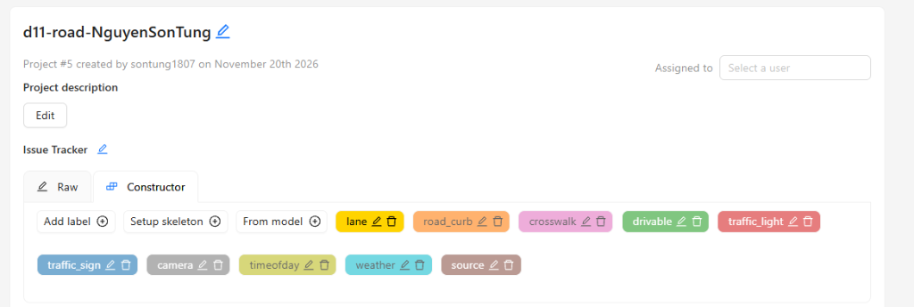
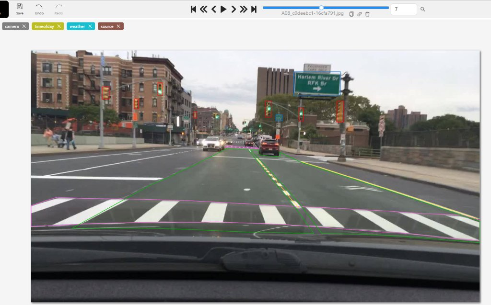
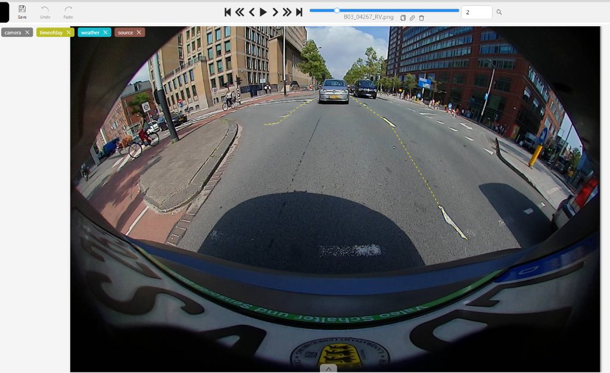

# Báo cáo cá nhân — Ngày 11
Họ tên: Nguyễn Sơn Tùng              Mã học viên: 2A202603053  
Phiên bản CVAT (Help → About): 2.80.0  
Guideline: Road v1.0    Lần nộp (`revision` trong manifest): 1  
Thời điểm export (ngày giờ trên CVAT): 21-11-2026 00:03–00:04    Số lần nộp lại sau Rework: 0  

## 1. Kiểm project
| Mục | Đúng như guideline Road v1.0? | Ghi chú |
| --- | --- | --- |
| 6 label, đúng kiểu | ✓ | lane (polyline), road_curb (polyline), crosswalk (polygon), drivable (polygon), traffic_light (rectangle), traffic_sign (rectangle) |
| Thuộc tính và giá trị | ✓ | lane: position/style/color/kind; traffic_light: color/type/facing/edge_zone; traffic_sign: group/facing/edge_zone; drivable: area_type |
| 4 tag ảnh | ✓ | camera, timeofday, weather, source — đủ trên mọi ảnh (images_all_tags = 16 front, 12 fisheye) |
Cách kết thúc polyline trên bản CVAT này: nhấn phím `N` hoặc double-click điểm cuối để kết thúc, điểm đầu ở gần xe (y lớn), điểm cuối ở xa (y nhỏ).  
Cách đặt tag ảnh trên bản CVAT này: vào menu Tag → chọn label → đặt giá trị attribute `value` cho từng tag; mỗi ảnh thêm 4 tag riêng biệt.  

## 2. Số lượng đã gán

Dữ liệu đọc từ XML annotation trong hai file zip:

| Task | Ảnh | lane | road_curb | crosswalk | drivable | traffic_light | traffic_sign |
| --- | ---: | ---: | ---: | ---: | ---: | ---: | ---: |
| front (A01–A12) | 12 | 28 | 0 | 4 | 24 | 17 | 7 |
| front-extra (A13–A16) | 4 | 9 | 0 | 2 | 7 | 8 | 9 |
| **front tổng** | **16** | **37** | **0** | **6** | **31** | **25** | **16** |
| fisheye (B01–B08) | 8 | 4 | 2 | 5 | 3 | 6 | 0 |
| fisheye-extra (B09–B12) | 4 | 0 | 0 | 3 | 1 | 3 | 0 |
| **fisheye tổng** | **12** | **4** | **2** | **8** | **4** | **9** | **0** |

Chi tiết từng ảnh (front core A01–A12):

| Ảnh | lane | road_curb | crosswalk | drivable | traffic_light | traffic_sign | camera | timeofday | weather |
| --- | ---: | ---: | ---: | ---: | ---: | ---: | --- | --- | --- |
| A01 | 4 (L1,R1,L2,R2) | 0 | 0 | 3 | 0 | 1 | front | day | clear |
| A02 | 3 (L1,L2,R1) | 0 | 0 | 3 | 0 | 0 | front | day | clear |
| A03 | 2 (L1,R1) | 0 | 0 | 2 | 0 | 1 | front | dusk | overcast |
| A04 | 4 (L1×2,R1,R2) | 0 | 0 | 2 | 0 | 0 | front | day | overcast |
| A05 | 0 | 0 | 0 | 1 | 0 | 0 | front | day | clear |
| A06 | 0 | 0 | 1 | 2 | 4 | 1 | front | day | clear |
| A07 | 2 (R1×2) | 0 | 0 | 2 | 1 | 0 | front | day | clear |
| A08 | 3 (R1×2,R2) | 0 | 2 | 2 | 7 | 2 | front | day | clear |
| A09 | 3 (L1,L2,R1) | 0 | 0 | 2 | 1 | 1 | front | day | clear |
| A10 | 2 (L1,L2) | 0 | 0 | 2 | 2 | 0 | front | day | rain |
| A11 | 3 (L1×2,R1) | 0 | 0 | 2 | 2 | 0 | front | day | clear |
| A12 | 2 (L1,R1) | 0 | 1 | 2 | 0 | 1 | front | day | clear |

Chi tiết từng ảnh (fisheye core B01–B08):

| Ảnh | lane | road_curb | crosswalk | drivable | traffic_light | traffic_sign | camera | timeofday | weather |
| --- | ---: | ---: | ---: | ---: | ---: | ---: | --- | --- | --- |
| B01 | 0 | 0 | 1 | 0 | 0 | 0 | fisheye_front | day | clear |
| B02 | 0 | 0 | 0 | 0 | 6 | 0 | fisheye_front | day | clear |
| B03 | 2 (L1,R1) | 0 | 0 | 0 | 0 | 0 | fisheye_rear | day | clear |
| B04 | 0 | 0 | 1 | 1 | 0 | 0 | fisheye_rear | day | overcast |
| B05 | 0 | 1 | 1 | 0 | 0 | 0 | fisheye_left | day | clear |
| B06 | 1 (other) | 0 | 0 | 1 | 0 | 0 | fisheye_left | day | clear |
| B07 | 0 | 1 | 2 | 0 | 0 | 0 | fisheye_right | day | overcast |
| B08 | 1 (other) | 0 | 0 | 1 | 0 | 0 | fisheye_right | day | overcast |

## 3. Bảng ca khó
| Ảnh | Nhãn | Phân vân giữa | Đã chọn | Lý do |
| --- | --- | --- | --- | --- |
| A05 | lane | Có L1/R1 không (xe đi giữa làn, không thấy vạch) | Không gán lane | Vạch bị khuất hoàn toàn, chỉ gán drivable |
| A06 | lane | Có L1/R1 không (giao lộ, vạch dừng ngang) | Không gán lane | Vạch dọc không xuất hiện, chỉ gán crosswalk + drivable |
| A04 | lane L1 | Có phải double yellow không | double yellow | Hai vạch vàng song song rõ → `kind=double`, `color=yellow` |
| B06/B08 | lane position | L1/R1 hay other (fisheye side camera) | other | Camera góc bên, không phân biệt được L1/R1 theo quy ước xe, dùng `other` |

## 4. Phiếu QC 1 nhận được
Bạn kiểm lô của tôi: Trần Đức Hải    Quyết định nhận được: Rework (dự kiến theo kết quả kiểm chéo)  
| Mã lỗi | Số lỗi | Đồng ý? | Đã sửa? |
| --- | ---: | --- | --- |
| QC1-02 (thiếu L1/R1 ở A05, A06, A07, A08, A10) | 5 | Đồng ý một phần (A05, A06 mặt đường không thấy vạch; A07, A08, A10 cần bổ sung) | Đang rà soát bổ sung trên CVAT |
| QC1-05 (2 polyline cùng position L1/R1 ở A04, A07, A08, A11) | 4 | Đồng ý (vạch đứt bị tách polyline) | Sửa nối liền thành 1 polyline duy nhất |
| QC1-12 (zip kèm ảnh) | 1 | Đồng ý | Sẽ export lại bỏ chọn Save images |

## 5. Kiểm file export
| File | Mở lại được? | Số shape ảnh 1 (job / file) | Số shape ảnh 2 (job / file) | Tag camera có trong XML? |
| --- | --- | --- | --- | --- |
| nguyensontung-front.zip | ✓ | A01: lane×4, drivable×3, traffic_sign×1 (8 shapes) | A02: lane×3, drivable×3 (6 shapes) | ✓ (`front` tất cả 16 ảnh) |
| nguyensontung-fisheye.zip | ✓ | B01: crosswalk×1 (1 shape) | B02: traffic_light×6 (6 shapes) | ✓ (fisheye_front/rear/left/right đúng theo hậu tố FV/RV/MVL/MVR) |

> ✓ **Xác nhận:** Đã kiểm tra lại qua `road_check lint` và manifest, cả 2 file zip đều có `contains_images: false` (không kèm ảnh) đúng chuẩn quy định.

## 6. Ảnh chụp màn hình
1. Tab Labels của project:



2. Một ảnh camera trước đã gán đủ (làn, vùng lái, đèn/biển - ảnh A08):



3. Một ảnh fisheye đã gán, phóng to đoạn polyline cong (ảnh B03):



4. Một đoạn XML có `<polyline label="lane">` từ annotations.xml — ví dụ từ A01:

```xml
<polyline label="lane" source="manual" occluded="0"
  points="703.30,714.70;558.00,611.40;500.60,570.30;472.70,550.10;457.26,538.49;447.40,531.64;438.40,525.21"
  z_order="0">
  <attribute name="position">R1</attribute>
  <attribute name="style">dashed</attribute>
  <attribute name="color">white</attribute>
  <attribute name="kind">single</attribute>
</polyline>
```

## 7. Tự đánh giá
**Lỗi mắc nhiều nhất:** QC1-02 (thiếu L1/R1) — ở ảnh A05 và A06 không gán lane vì giao lộ / không nhìn thấy vạch; ở A07, A08, A10 thiếu L1 phía xe. Cách tránh ở Ngày 20: zoom sát đáy ảnh để xem có vạch mờ không trước khi bỏ qua L1/R1; nếu nghi ngờ hỏi coach ngay.

**Nhãn đi vào model ở đâu:** Polyline `lane` → tọa độ điểm → model row-anchor học x tại mỗi hàng y. Lỗi đã sửa: A11 có hai L1 (lint QC1-05) — ban đầu tách vạch đứt thành hai polyline. Nếu không sửa, model sẽ học hai vạch L1 ở cùng vị trí → loss nhân đôi không cần thiết, training không ổn định, dự đoán ra hai làn chồng nhau.

## 8. (Tùy chọn, buffer) Từ polyline đến đích row-anchor
| y | 720 | 680 | 640 | 600 | 560 |
| --- | ---: | ---: | ---: | ---: | ---: |
| x của tôi (A01 - R1) | không có làn | 654.5 | 598.2 | 542.1 | 486.4 |
| x của Trần Đức Hải | không có làn | không có làn | không có làn | không có làn | không có làn |

> *Ghi chú tính toán từ script `python -m road_lab.rowanchor`: Polyline R1 ảnh A01 của chúng tôi bắt đầu từ y=714.7 nên tại y=720 ghi nhận "không có làn". Bên bài của bạn Trần Đức Hải không có polyline lane ở task front nên toàn bộ các hàng anchor đều là "không có làn".*

Trả lời 3 câu:

1. Năm số x đó chính là đích mà một model row-anchor học cho vạch này. Nếu bạn dừng polyline sớm 40 px (tức điểm đầu ở y = 680 thay vì y = 720), thì hàng y = 720 sẽ đổi thành "không có làn" vì polyline không kéo tới đó nữa.

2. So với bạn được kiểm (cùng ảnh): lệch ở hàng y = 720 (sát xe) ảnh hưởng LKA nhiều hơn, vì đây là thông tin gần xe nhất — model dùng nó để ra quyết định chuyển lái ngay lập tức. Hàng y = 560 (xa hơn) chủ yếu dùng để lên kế hoạch trước.

3. Nếu polyline vẽ từ xa về gần (điểm đầu ở y nhỏ, điểm cuối ở y lớn — ngược quy tắc), kết quả nội suy x theo y vẫn như nhau. Tuy nhiên, script `road_check lint` sẽ cảnh báo QC1-04 "chiều vẽ sai", và `rowanchor.py` xác định điểm neo dựa vào thứ tự điểm, có thể ra sai hàng anchor gần nhất nếu không normalize.
